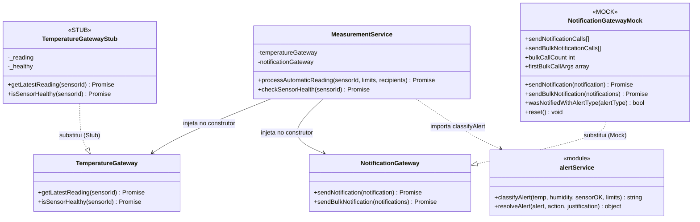

# Matriz de Rastreabilidade — Sprint 6: Duplos de Teste

O Sprint 6 incidiu sobre a aplicação do padrão de **duplos de teste** (*test doubles*) para isolar o `MeasurementService` das suas dependências externas — hardware de sensores e serviços de notificação — permitindo testar a lógica de negócio de forma determinística, sem rede, hardware real ou serviços de terceiros.

Os testes foram implementados com **Jest** no ficheiro `tests/sprint6_doubles_test.js`, exercitando o serviço via injeção de dependência. A análise mapeia cada caso de teste ao duplo utilizado, à regra de negócio coberta e à técnica aplicada.

O `MeasurementService` possui **2 dependências externas injetadas** (`TemperatureGateway` e `NotificationGateway`) e **1 decisão de classificação** delegada ao `alertService`. O fluxo principal (`processAutomaticReading`) contém **3 estruturas de decisão atómicas** — condição de sensor, condição de limites de temperatura, condição de limites de humidade — e **1 guarda de efeito lateral** (envio de notificação apenas para Warning/Critical).

---

## Justificação dos Duplos

### TemperatureGateway → STUB

A medição de temperatura é um processo automático e de **leitura passiva**. O `MeasurementService` invoca o gateway para obter leituras e não precisa de saber se o gateway foi chamado — precisa apenas de **controlar os valores devolvidos** (temperatura dentro/fora dos limites, sensor avariado). O stub é o duplo mais simples e adequado: substitui o hardware real com respostas pré-configuradas, sem overhead de verificação de interações.

### NotificationGateway → MOCK

O envio de notificações é um **efeito lateral observável e crítico**. Não basta verificar que a classificação de alerta está correta — é necessário garantir que o gateway foi **efetivamente chamado**, com os **argumentos corretos** (destinatário, tipo de alerta, canal), e o **número esperado de vezes**. O mock é o duplo adequado para verificar estas interações.

---

## Defects / Observações descobertas durante o Sprint 6

| ID | Descrição | Ficheiro | Gravidade | Estado |
|---|---|---|---|---|
| DEF-01 | `resolveAlert()` muta diretamente o objeto `alert` recebido e retorna a mesma referência, em vez de criar uma cópia. Qualquer código que guarde a referência original observa o estado alterado sem ter sido notificado. Correção sugerida: `return { ...alert, status: '...', justification: ... }`. | `src/services/alertService.js` | Média | Aberto |
| GAP-01 | O limite superior exato de humidade (80 %) não é testado nos 25 testes originais — apenas os limites de temperatura têm os dois extremos cobertos. | `tests/sprint6_doubles_test.js` | Baixa (cobertura incompleta) | Documentado |
| GAP-02 | O caminho `isSensorHealthy → false` (sensor inoperacional em `checkSensorHealth`) não tem caso de teste dedicado. | `tests/sprint6_doubles_test.js` | Baixa (cobertura incompleta) | Documentado |

---

## Diagrama de Classes — Arquitetura com Duplos



> **Legenda:** `──>` dependência injetada no construtor · `..>` importação de módulo · `..|>` substituição por duplo de teste · `<<STUB>>` devolve valores pré-configurados, não verifica chamadas · `<<MOCK>>` regista chamadas e argumentos para verificação posterior

### Padrão de Injeção de Dependência

```js
// Produção:
const svc = new MeasurementService(
    new TemperatureGateway(),   // real: comunica com sensor físico (MQTT/HTTP)
    new NotificationGateway()   // real: comunica com SendGrid/Twilio
);

// Testes (Sprint 6):
const svc = new MeasurementService(
    new TemperatureGatewayStub({ temperature: 23, humidity: 60, sensorOK: true }),
    new NotificationGatewayMock()
);
```

---

## 1. Matriz de Rastreabilidade — Suite A: Stub do TemperatureGateway

> **Objetivo:** substituir o hardware de sensores por um stub com valores controlados e verificar a classificação de alertas produzida pelo `MeasurementService`.

| ID | Requisito / Regra | Componente | Nível | Técnica | Resultado Esperado | Pré-condições |
|---|---|---|---|---|---|---|
| TU-SP6-01 | RN-02: leitura nominal dentro dos limites → `Informative` | `MeasurementService` (stub) | Unidade | PE (classe válida) | `alertType = 'Informative'`; `reading.temperature = 23`, `reading.humidity = 60` | Stub com `temp=23, hum=60, sensorOK=true` |
| TU-SP6-02 | RN-02 + AVL: limite inferior de temperatura exato (18 °C) aceite | `MeasurementService` (stub) | Unidade | AVL (limite exato) | `alertType = 'Informative'` | Stub com `temp=18, hum=60, sensorOK=true` |
| TU-SP6-03 | RN-02 + AVL: temperatura imediatamente abaixo do limite inferior (17 °C) rejeitada | `MeasurementService` (stub) | Unidade | AVL (abaixo do limite) | `alertType = 'Warning'` | Stub com `temp=17, hum=60, sensorOK=true` |
| TU-SP6-04 | RN-02 + AVL: limite superior de temperatura exato (28 °C) aceite | `MeasurementService` (stub) | Unidade | AVL (limite exato) | `alertType = 'Informative'` | Stub com `temp=28, hum=60, sensorOK=true` |
| TU-SP6-05 | RN-02 + AVL: temperatura imediatamente acima do limite superior (29 °C) rejeitada | `MeasurementService` (stub) | Unidade | AVL (acima do limite) | `alertType = 'Warning'` | Stub com `temp=29, hum=60, sensorOK=true` |
| TU-SP6-06 | RN-02: sensor avariado (`sensorOK=false`) prevalece sobre qualquer leitura → `Informative` | `MeasurementService` (stub) | Unidade | MCC (C1: `!sensorOK` = T) | `alertType = 'Informative'`; `reading.sensorOK = false` | Stub com `temp=35, hum=90, sensorOK=false` |
| TU-SP6-07 | RN-02: ambos temperatura e humidade fora dos limites → `Critical` | `MeasurementService` (stub) | Unidade | MCC (C2=F e C3=F em simultâneo) | `alertType = 'Critical'` | Stub com `temp=35, hum=90, sensorOK=true` |
| TU-SP6-08 | RN-02 + AVL: limite inferior de humidade exato (40 %) aceite | `MeasurementService` (stub) | Unidade | AVL (limite exato) | `alertType = 'Informative'` | Stub com `temp=23, hum=40, sensorOK=true` |
| TU-SP6-09 | RN-02 + AVL: humidade imediatamente abaixo do limite inferior (39 %) rejeitada | `MeasurementService` (stub) | Unidade | AVL (abaixo do limite) | `alertType = 'Warning'` | Stub com `temp=23, hum=39, sensorOK=true` |
| TU-SP6-10 | RN-07: `checkSensorHealth` delega em `isSensorHealthy` do stub → sensor operacional | `MeasurementService` (stub) | Unidade | PE (sensor operacional) | retorna `true` | Stub configurado com `healthy=true` |

### Tabela de Verdade MCC — `classifyAlert` (3 condições atómicas)

| Caso | C1: `!sensorOK` | C2: `tempOK` | C3: `humidityOK` | Resultado | Testes |
|---|---|---|---|---|---|
| 1 | T | — | — | `Informative` (curto-circuito) | TU-SP6-06 |
| 2 | F | T | T | `Informative` | TU-SP6-01, 02, 04, 08 |
| 3 | F | F | T | `Warning` | TU-SP6-03, 05 |
| 4 | F | T | F | `Warning` | TU-SP6-09 |
| 5 | F | F | F | `Critical` | TU-SP6-07 |

### Análise de Valores Limite — Temperatura `[18, 28]`

| Valor | Posição AVL | Resultado Esperado | Teste |
|---|---|---|---|
| 17 °C | Imediatamente abaixo do mínimo | `Warning` | TU-SP6-03 |
| 18 °C | Mínimo exato | `Informative` | TU-SP6-02 |
| 23 °C | Interior nominal | `Informative` | TU-SP6-01 |
| 28 °C | Máximo exato | `Informative` | TU-SP6-04 |
| 29 °C | Imediatamente acima do máximo | `Warning` | TU-SP6-05 |

### Análise de Valores Limite — Humidade `[40, 80]`

| Valor | Posição AVL | Resultado Esperado | Teste |
|---|---|---|---|
| 39 % | Imediatamente abaixo do mínimo | `Warning` | TU-SP6-09 |
| 40 % | Mínimo exato | `Informative` | TU-SP6-08 |
| 60 % | Interior nominal | `Informative` | TU-SP6-01 |
| 80 % | Máximo exato | `Informative` | ⚠ GAP-01 — não coberto nos originais |
| 81 % | Imediatamente acima do máximo | `Warning` | TU-SP6-24 (Suite C) |

---

## 2. Matriz de Rastreabilidade — Suite B: Mock do NotificationGateway

> **Objetivo:** verificar que o gateway de notificação é chamado com os argumentos corretos, o número certo de vezes, e **apenas** quando o alerta o justifica — garantindo o efeito lateral observável.

| ID | Requisito / Regra | Componente | Nível | Técnica | Resultado Esperado | Pré-condições |
|---|---|---|---|---|---|---|
| TU-SP6-11 | RN-06: alerta `Informative` não desencadeia notificação | `MeasurementService` (mock) | Unidade | PE (ausência de efeito lateral) | `mock.bulkCallCount = 0` | Mock limpo; stub com leitura nominal; 2 destinatários definidos |
| TU-SP6-12 | RN-06: alerta `Warning` desencadeia exatamente uma chamada a `sendBulkNotification` | `MeasurementService` (mock) | Unidade | PE (efeito lateral presente) | `mock.bulkCallCount = 1` | Mock limpo; stub com `temp=17`; 2 destinatários definidos |
| TU-SP6-13 | RN-06: payload da chamada contém `alertType = 'Warning'` | `MeasurementService` (mock) | Unidade | Verificação de argumentos | `mock.wasNotifiedWithAlertType('Warning') = true` | Mock limpo; stub com `temp=17` |
| TU-SP6-14 | RN-06: alerta `Critical` desencadeia exatamente uma chamada a `sendBulkNotification` | `MeasurementService` (mock) | Unidade | PE (efeito lateral presente) | `mock.bulkCallCount = 1` | Mock limpo; stub com `temp=35, hum=90` |
| TU-SP6-15 | RN-06: payload da chamada contém `alertType = 'Critical'` | `MeasurementService` (mock) | Unidade | Verificação de argumentos | `mock.wasNotifiedWithAlertType('Critical') = true` | Mock limpo; stub com `temp=35, hum=90` |
| TU-SP6-16 | RN-06: batch enviado contém uma entrada por cada destinatário definido | `MeasurementService` (mock) | Unidade | Verificação de argumentos | `batch.length = 2` | Mock limpo; stub `Critical`; 2 destinatários definidos |
| TU-SP6-17 | RN-06: payload contém o email correto do primeiro destinatário | `MeasurementService` (mock) | Unidade | Verificação de argumentos | `batch[0].recipientEmail = 'responsavel@greenherb.pt'` | Mock limpo; destinatários com email definido |
| TU-SP6-18 | RN-06: todas as notificações do batch usam canal `'email'` | `MeasurementService` (mock) | Unidade | Verificação de argumentos | `∀ n ∈ batch: n.channel = 'email'` | Mock limpo; stub `Critical`; 2 destinatários definidos |
| TU-SP6-19 | RN-06: lista de destinatários vazia impede chamada ao gateway mesmo com `Critical` | `MeasurementService` (mock) | Unidade | PE (guarda de lista vazia) | `mock.bulkCallCount = 0`; `notificationSent = false` | Mock limpo; stub `Critical`; `recipients = []` |
| TU-SP6-20 | RN-06: sensor avariado → `Informative` → gateway não é chamado | `MeasurementService` (mock) | Unidade | MCC (`sensorOK=false` curto-circuita o envio) | `mock.bulkCallCount = 0` mesmo com 2 destinatários | Mock limpo; stub com `sensorOK=false, temp=35, hum=90` |

### Tabela de Decisão — Guarda de Envio de Notificação

| alertType | recipients.length | notificationSent | mock.bulkCallCount | Testes |
|---|---|---|---|---|
| `Informative` | > 0 | `false` | 0 | TU-SP6-11 |
| `Informative` (sensor avariado) | > 0 | `false` | 0 | TU-SP6-20 |
| `Warning` | > 0 | `true` | 1 | TU-SP6-12, 13 |
| `Critical` | > 0 | `true` | 1 | TU-SP6-14, 15 |
| `Critical` | = 0 | `false` | 0 | TU-SP6-19 |

---

## 3. Matriz de Rastreabilidade — Suite C: Cenários Combinados (Stub + Mock)

> **Objetivo:** validar o fluxo end-to-end da unidade — leitura do stub → classificação via `alertService` → decisão de notificação via mock — confirmando que os dois duplos interagem corretamente.

| ID | Requisito / Regra | Componente | Nível | Técnica | Resultado Esperado | Pré-condições |
|---|---|---|---|---|---|---|
| TU-SP6-21 | RN-02 + RN-06: leitura nominal → `Informative` → sem notificação → `notificationSent=false` | `MeasurementService` (stub+mock) | Unidade | Combinado | `alertType='Informative'`; `notificationSent=false`; `bulkCallCount=0` | Stub nominal; mock limpo; 2 destinatários definidos |
| TU-SP6-22 | RN-02 + RN-06: temperatura fora dos limites → `Warning` → notificação enviada → `notificationSent=true` | `MeasurementService` (stub+mock) | Unidade | Combinado | `alertType='Warning'`; `notificationSent=true`; `bulkCallCount=1` | Stub `temp=29`; mock limpo; 2 destinatários definidos |
| TU-SP6-23 | RN-02 + RN-06: ambos fora dos limites → `Critical` → notificação com `alertType='Critical'` | `MeasurementService` (stub+mock) | Unidade | Combinado | `alertType='Critical'`; `mock.wasNotifiedWithAlertType('Critical') = true` | Stub `temp=35, hum=15`; mock limpo; 2 destinatários definidos |
| TU-SP6-24 | RN-02 + RN-06 + AVL: humidade 81 % (AVL acima do máximo) → `Warning` → notificação enviada | `MeasurementService` (stub+mock) | Unidade | AVL + Combinado | `alertType='Warning'`; `notificationSent=true` | Stub `temp=23, hum=81`; mock limpo; 2 destinatários definidos |
| TU-SP6-25 | RN-07: `mock.reset()` isola contagens entre cenários — segunda leitura nominal não incrementa `bulkCallCount` | `MeasurementService` (stub+mock) | Unidade | Isolamento de estado | Após reset: `bulkCallCount=0` independentemente do cenário anterior | Mock após chamada `Critical` prévia; reset manual; stub nominal |

---

## 4. Ficheiros Criados

| Ficheiro | Tipo | Descrição |
|---|---|---|
| `src/gateways/temperatureGateway.js` | Interface (gateway real) | Contrato do gateway de temperatura; em produção comunica com sensor físico via MQTT/HTTP |
| `src/gateways/notificationGateway.js` | Interface (gateway real) | Contrato do gateway de notificações; em produção comunica com SendGrid/Twilio |
| `src/services/measurementService.js` | Serviço | Orquestrador que recebe os gateways por injeção de dependência no construtor |
| `tests/sprint6_doubles_test.js` | Testes | 25 testes organizados em 3 suites (A — Stub, B — Mock, C — Combinados) |

---

## 5. Cobertura Bidirecional — Requisito → Casos de Teste

| Requisito / Regra | Casos de Teste |
|---|---|
| RN-02: classificação `Informative` (leitura dentro dos limites) | TU-SP6-01, TU-SP6-02, TU-SP6-04, TU-SP6-08, TU-SP6-21 |
| RN-02: classificação `Informative` (sensor avariado prevalece) | TU-SP6-06, TU-SP6-20 |
| RN-02: classificação `Warning` (temperatura fora) | TU-SP6-03, TU-SP6-05, TU-SP6-22 |
| RN-02: classificação `Warning` (humidade fora) | TU-SP6-09, TU-SP6-24 |
| RN-02: classificação `Critical` (ambos fora) | TU-SP6-07, TU-SP6-23 |
| RN-06: notificação enviada para `Warning` e `Critical` | TU-SP6-12, TU-SP6-13, TU-SP6-14, TU-SP6-15, TU-SP6-22, TU-SP6-23, TU-SP6-24 |
| RN-06: notificação não enviada para `Informative` | TU-SP6-11, TU-SP6-21 |
| RN-06: notificação não enviada sem destinatários | TU-SP6-19 |
| RN-06: argumentos do payload (email, canal, alertType, nº destinatários) | TU-SP6-16, TU-SP6-17, TU-SP6-18 |
| RN-07: saúde do sensor (`checkSensorHealth`) | TU-SP6-10 |
| AVL: limites de temperatura `[18, 28]` | TU-SP6-02, TU-SP6-03, TU-SP6-04, TU-SP6-05 |
| AVL: limites de humidade `[40, 80]` | TU-SP6-08, TU-SP6-09, TU-SP6-24 |
| DEF-01: mutação em `resolveAlert` | — (documentado; não testado nos originais) |
| GAP-01: limite superior de humidade exato (80 %) | — (não coberto nos originais) |
| GAP-02: `isSensorHealthy → false` | — (não coberto nos originais) |

---

## 6. Resumo da Execução

```
Test Suites: 1 passed, 1 total
Tests:       25 passed, 25 total
Snapshots:   0 total
Tempo total: ~0.4 s
```

### Distribuição por técnica

| Técnica | Nº de casos |
|---|---|
| Particionamento de Equivalência — PE (classe válida/inválida, efeito lateral presente/ausente) | 8 |
| Análise de Valores Limite — AVL (limites exatos e vizinhos imediatos) | 9 |
| Cobertura de Condições Múltiplas — MCC (`sensorOK`, `tempOK`, `humidityOK`) | 4 |
| Verificação de argumentos do mock (email, canal, alertType, nº destinatários) | 3 |
| Cenários combinados Stub + Mock (fluxo end-to-end da unidade) | 5 |
| Isolamento de estado entre testes (`mock.reset()`) | 1 |
| **Total Sprint 6** | **25** |

### Distribuição acumulada por nível

| Nível | Sprint 1 | Sprint 2 | Sprint 3 | Sprint 4 | Sprint 5 | Sprint 6 | Total |
|---|---|---|---|---|---|---|---|
| Unidade | 15 | 31 | ~50 est. | 0 | 52 | **25** | **~173** |
| Integração | 0 | 0 | 0 | 74 | 0 | 0 | 74 |
| Sistema | 0 | 0 | 0 | 0 | 0 | 0 | 0 |
